# ESP32-S3 Touch Display

A home dashboard and games console for a 4.3" ESP32-S3 touch screen, written in C with
**ESP-IDF 5.5** and **LVGL 8.4**. It has a launcher with app tiles, a world clock, weather,
a stock watchlist, five games and a settings app, and it can run **apps loaded from the SD card**
(signed, so only apps you trust run). A scrolling info ticker along the bottom of the home screen
keeps the weather and stocks up to date in the background.

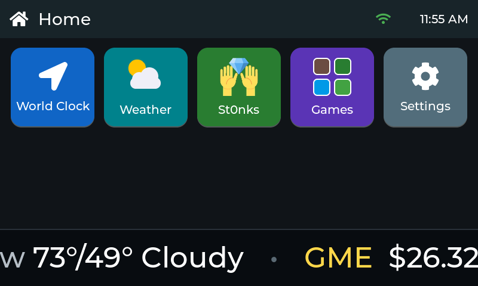

All screenshots were taken on the real device (see [Screenshots](#taking-screenshots)).

## Hardware

**[Waveshare ESP32-S3-Touch-LCD-4.3B-BOX](https://docs.waveshare.com/ESP32-S3-Touch-LCD-4.3B)**
(SKU 28141): the ESP32-S3-Touch-LCD-4.3B board, already mounted in Waveshare's plastic case.
Nothing else is attached; it's powered and programmed over its USB-C port.

| Part | Details |
|---|---|
| Module | ESP32-S3-WROOM-1-N16R8 (dual-core Xtensa LX7, 240 MHz, Wi-Fi 2.4 GHz + Bluetooth LE), chip revision v0.2 |
| Memory | **16 MB** flash, **8 MB** octal PSRAM |
| Display | 4.3" IPS, **800 x 480**, 16-bit RGB parallel interface (ST7701) |
| Touch | **GT911** capacitive touch (I2C: SDA GPIO8, SCL GPIO9, INT GPIO4) |
| I/O expander | **CH422G** on the same I2C bus: touch reset, LCD backlight (on/off only, no dimming), SD card chip select, 2 isolated digital inputs and 2 open-drain outputs |
| Clock | **PCF85063** real-time clock on I2C. A backup battery can be fitted but isn't in this unit, so it keeps time across resets and reflashes but not power loss |
| microSD | Card slot on SPI (MOSI GPIO11, CLK GPIO12, MISO GPIO13; chip select via the CH422G). FAT32 and exFAT cards; used for photos, files, screenshots, backups and Wi-Fi network import (see [SD card](#sd-card)) |
| Also on the board (not used yet) | RS485, CAN, digital in/out terminals |
| USB | USB-C to the ESP32-S3's built-in USB-Serial/JTAG (shows up as `/dev/ttyACM0` on Linux) |

Board documentation and schematic:
[Waveshare wiki](https://docs.waveshare.com/ESP32-S3-Touch-LCD-4.3B),
[schematic PDF](https://files.waveshare.com/wiki/ESP32-S3-Touch-LCD-4.3B/ESP32-S3-Touch-LCD-4.3B-Sch.pdf).

## Features

### Home screen and launcher

- Tile grid of apps, with a clock, Wi-Fi status and a **gear button for Settings** in the top bar.
  Games live in a **Games folder**. When there are more tiles than fit, swipe up and down to scroll.
- **Rearrange the tiles**: hold a tile until it lifts, drag it to a new place (drag to the top or
  bottom edge to scroll), then tap **Done**. Works inside folders too; the order is saved and is part
  of settings backups. New apps start at the end.
- The top bar also shows the soonest running timer, or the next alarm (in orange).
- **Info ticker** (optional, Settings > Display): a strip along the bottom fifth of the home
  screen that scrolls the weather for the cities you pick (now, today and tomorrow) and your
  stock watchlist (price, today's change, next earnings call). Its data refreshes in the
  background even when the Weather and St0nks apps are closed.
- **Screen timeout**: after a chosen time without touches, the backlight turns off, or (Settings >
  Display, "When the screen times out") a **photo slideshow** starts. The tap that wakes it doesn't
  press anything.
- Optional FPS / CPU meter.

### World Clock

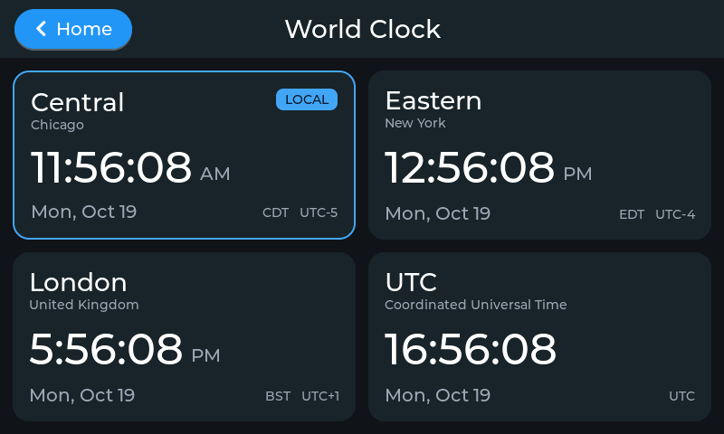

Four cards: US Central (local), Eastern, London and UTC, with the date and UTC offset. Time comes
from the internet (NTP) and is saved to the board's RTC chip, so it's correct straight after a
reset even before Wi-Fi connects. 12- or 24-hour format.

### Timers

| | |
|---|---|
| 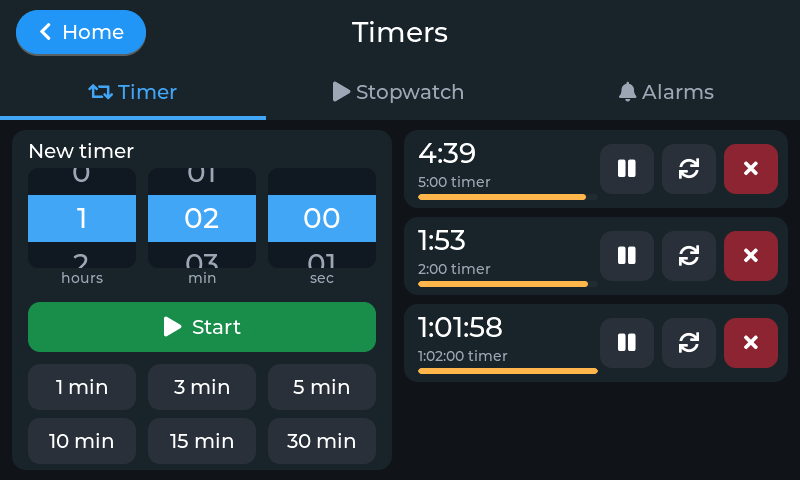 | 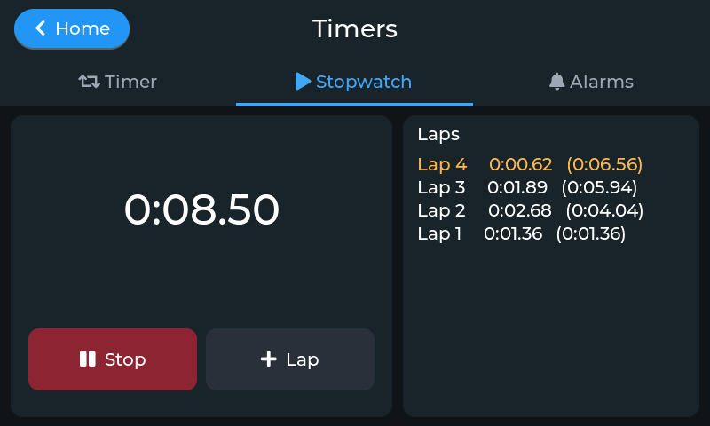 |
| 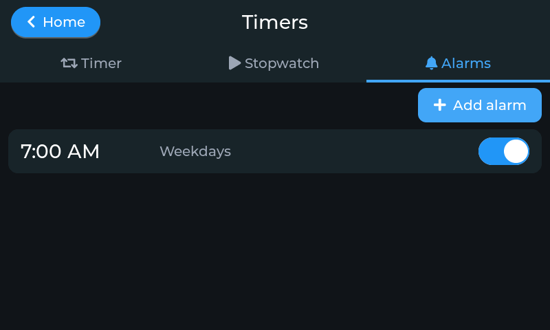 | 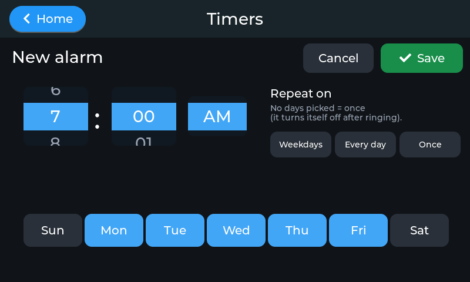 |

- **Timer**: set hours / minutes / seconds, or tap a preset (1 to 30 min). Up to 4 run at once,
  each with pause, restart and remove.
- **Stopwatch**: start / stop, laps (each lap's time and the running total), reset.
- **Alarms**: up to 6, each with a time and the days it repeats (weekdays, every day, any days you
  pick, or once: a one-time alarm turns itself off after ringing). On/off switch per alarm. Saved
  in flash, so they survive restarts and are included in settings backups.
- Everything keeps running when you leave the app. When a timer ends or an alarm is due, the
  screen wakes (also from screen-off or the photo screensaver) and **flashes red** with a big
  message until you tap **Dismiss** (alarms also have **Snooze 9 min**). The board has no
  speaker, so it's silent.
- Timers and the stopwatch use the chip's own timer, so they work without the clock being set,
  but they're lost on a restart. Alarms need the real time (from Wi-Fi or the RTC).

### Weather

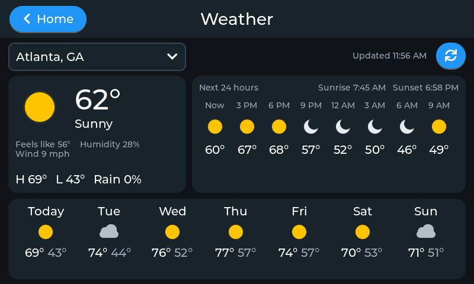

Current conditions, the next 24 hours and a 7-day forecast from [Open-Meteo](https://open-meteo.com/)
(free, no API key). Six saved locations to switch between; refreshes every 15 minutes. The
weather icons are drawn with LVGL shapes, not images.

### St0nks

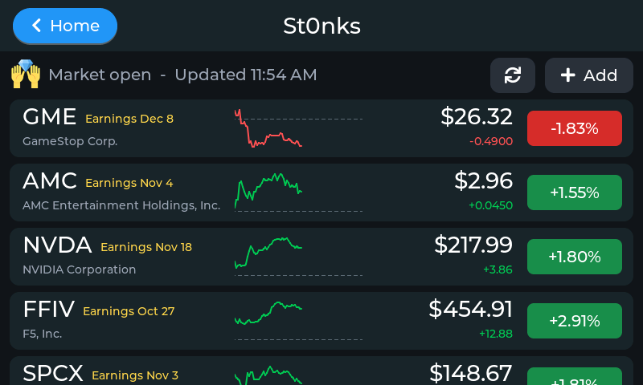

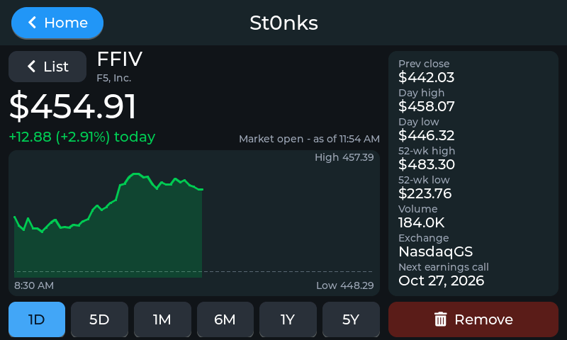

A stock watchlist named after the meme, with a diamond-hands icon.

- **List:** each symbol's price, today's change, a sparkline of the day and the date of the next
  earnings call (or the last one, if the next isn't announced yet).
- **Detail:** tap a stock for a large chart with 1D / 5D / 1M / 6M / 1Y / 5Y ranges (touch and drag
  on the chart to read the price at any point), previous close, day and 52-week high/low,
  volume, exchange and the earnings call date.
- **Add** symbols with the on-screen keyboard (stocks, ETFs, indexes such as `^GSPC`, crypto such as
  `BTC-USD`, futures such as `GC=F`), and remove them from the detail view. The list (up to 20)
  is saved in flash.
- Prices from Yahoo Finance's public chart API (delayed, no key), refreshed every 15 minutes or
  with the refresh button. Earnings dates from Nasdaq's public API (US company stocks only).

### Photos

A slideshow of the pictures in `dashboard/pictures/` on the SD card (and folders inside it, up to
3 deep), cross-fading between them.

| | |
|---|---|
| 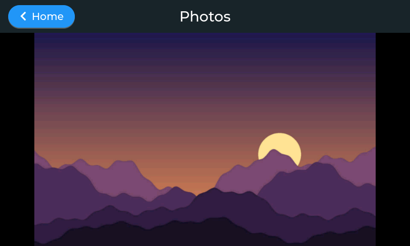 | 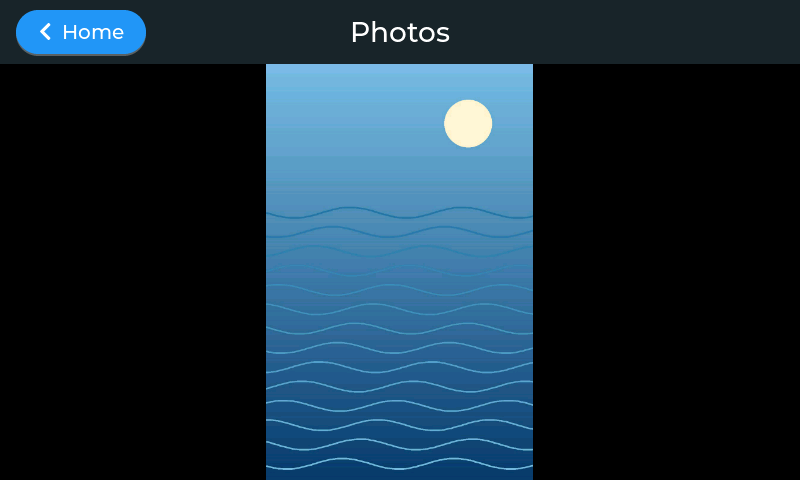 |

- **Formats**: JPEG, PNG, GIF (first frame) and BMP (24/32-bit). Not supported: progressive JPEG,
  interlaced PNG, HEIC and WebP (convert them to JPEG). Unsupported or damaged files are skipped.
- **Any size**: pictures are shrunk while they're read, so 12+ megapixel phone photos and large PNGs
  work (big PNGs take a few seconds). Phone photos are turned upright using their EXIF rotation.
- **Controls** (tap the picture): previous / next, pause, time per picture (5 s to 5 min),
  shuffle, Fit (whole picture) or Fill (fills the screen, edges cropped), Full screen, and
  **delete** (asks first, then erases the file from the card). The bar hides itself after 5 s.
- The screen timeout is skipped while Photos is open, so it works as a photo frame.

### Files

A file manager for the SD card. It opens in the `dashboard` folder, and **Up** goes as far as the
top of the card.

| | |
|---|---|
| 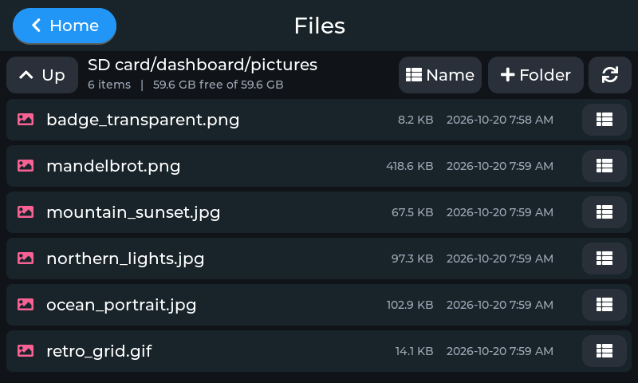 | 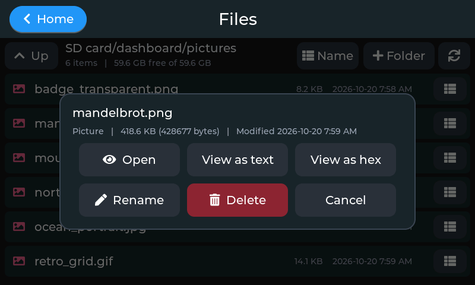 |
| 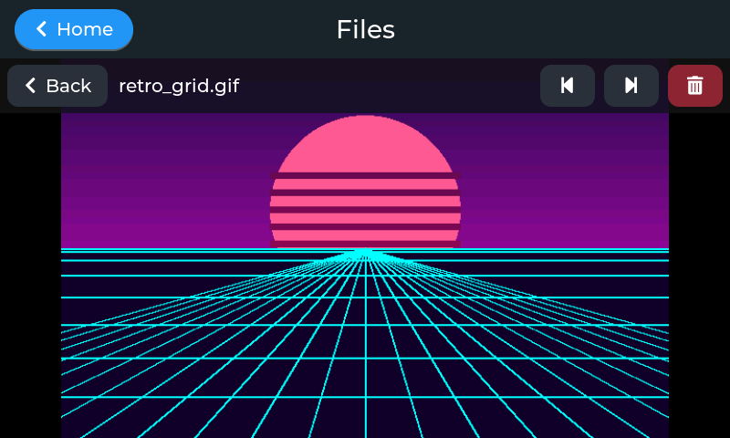 | 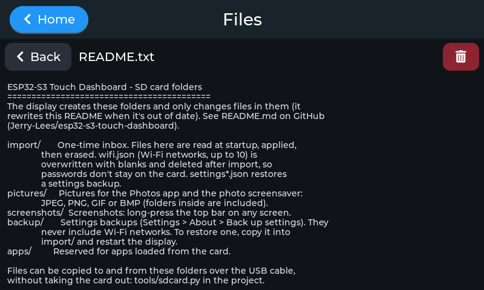 |

- Shows each item's size and date, the number of items, and the card's free space. Sort by name,
  date (newest first) or size (biggest first); folders come first. Large folders are shown 50 at a
  time.
- Tap to open: folders, pictures (full screen, previous / next, delete) and text files (the first
  32 KB). Any file can be viewed as text or as hex (first 4 KB).
- The row menu (the list button, or long-press a row) shows details and offers **Rename**,
  **Delete** (folders with everything in them, after asking) and the viewers. **+ Folder** makes a
  new folder.
- Safety: the dashboard's own folders can't be renamed or deleted, and files named `wifi*.json`
  (which may hold Wi-Fi passwords) are never shown.

### Jellyfin

Shows what's playing on your [Jellyfin](https://jellyfin.org) media server: cover art, title,
artist and album (or series, season and episode), who is watching on which device, and a
progress bar.

| | |
|---|---|
| 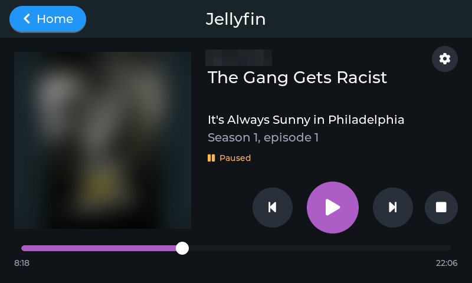 | 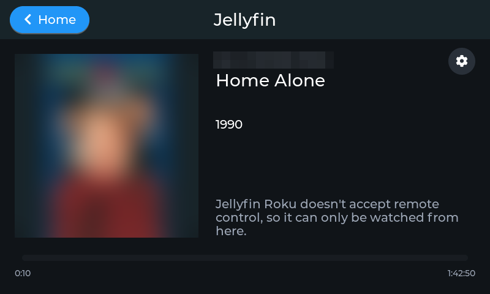 |

*In these screenshots the cover art (copyrighted posters) and the user/device line are blurred
for this documentation only. On the display, the cover art and the user and device names show
normally.*

- **Previous / play-pause / next / stop** control the player remotely, and dragging the progress
  bar jumps to that point (left: the web player, paused).
- **Some apps, like the Jellyfin Roku app, don't support remote control.** For those the buttons
  are hidden and a note says so (right); you can still see what's playing and how far along it
  is. This is a limit of the player app: Jellyfin's own dashboard can't control them either.
- When several devices are playing, **< 1 of 2 >** arrows switch between them.
- The app asks the server every 2 seconds, only while it's open.

#### Setting up Jellyfin

The app needs your server's address and an **API key**. To make a key, open Jellyfin in a browser
and go to **Dashboard > API Keys** (under Advanced), click **+** and give it a name such as
`Dashboard`. A Jellyfin key is 32 characters of `0-9` and `a-f`. (Jellyseerr/Overseerr keys look
different and won't work.)

There are two ways to give them to the display:

- **On the display:** open the app, tap the gear (top right) and type the address and key.
- **In a settings file, before building** (easier than typing a 32-character key): create
  `main/jellyfin_secrets.h`:
  ```c
  #pragma once
  #define JELLYFIN_URL     "http://192.168.1.20:8096"
  #define JELLYFIN_API_KEY "0123456789abcdef0123456789abcdef"
  ```
  Use your server's address (with `http://` or `https://` and the port, usually 8096) and your
  key, then build and flash. The display copies them into its own storage at start-up, and again
  whenever you change the file and flash again. Without the file, the app just asks you to set it
  up.

How the key is kept safe:

- `main/jellyfin_secrets.h` is in `.gitignore`, so it's never committed. Like the Wi-Fi password
  in `wifi_secrets.h`, it does end up inside the firmware you flash, so don't share firmware
  files.
- On the display, the address and key live in their own storage area, **not** in settings
  backups, and are never written to the log. The setup page never shows the saved key.
- **Forget** on the setup page (tap twice) erases them. They stay forgotten until you change
  `jellyfin_secrets.h` and flash again.
- With an `http://` address the key travels unencrypted over your home network on each request.
  That's normal for a Jellyfin server on a LAN; use `https://` if your server has it.

### DashPad

A macro pad: pages of big buttons (5 x 3 per page, up to 8 pages) that do things on your PC or
your network.

| | |
|---|---|
| 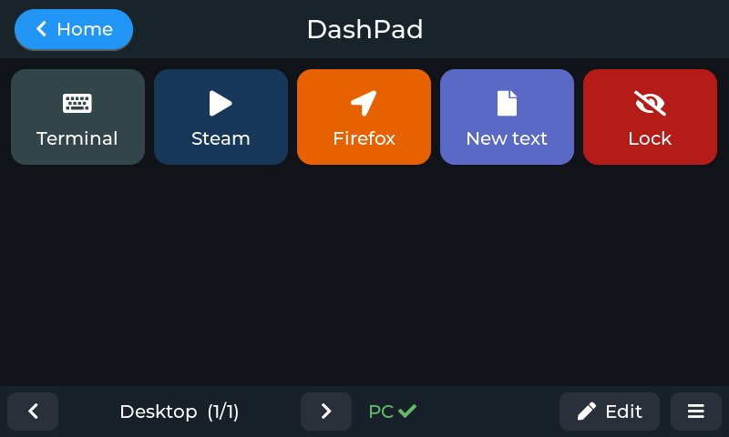 | 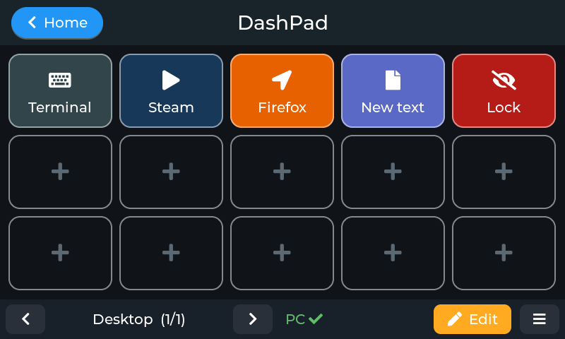 |
| 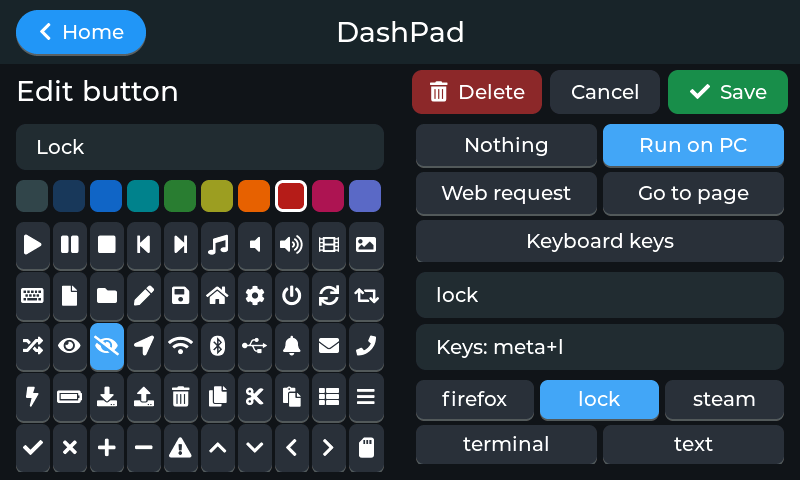 | 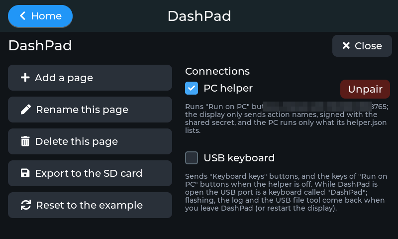 |

Each button has a label, a symbol and a colour, and one action:

- **Run on PC:** asks the PC helper (below) to run a named action, such as opening a terminal.
  It can also have **keys** to send instead when the helper is off or can't be reached.
- **Keyboard keys:** the display acts as a USB keyboard and presses a combo such as
  `ctrl+alt+t`, `meta+l`, `f13` or a media key (`play`, `next`, `prev`, `stop`, `mute`, `volup`,
  `voldown`).
- **Web request:** a GET or POST to any URL, such as a Home Assistant webhook.
- **Go to page:** switches to another page (folder-style buttons).

**Editing:** tap **Edit** to see the empty slots, then tap a button or a `+` slot (or hold any
button). The **≡ menu** adds, renames and deletes pages, exports the layout to
`dashboard/backup/` on the SD card, and resets to the example. To load a layout written on the
PC, copy it as `dashboard/import/dashpad.json` and restart the display (the file is deleted after
import). [`dashpad/dashpad.json`](dashpad/dashpad.json) is the example and the built-in default:
Terminal, Steam, Firefox, New text and Lock.

**Connections** (in the ≡ menu), each switched on or off:

- **PC helper** (on by default): `tools/dashpad_helper.py`, a small program on your PC that runs
  "Run on PC" buttons over Wi-Fi.
- **USB keyboard** (off by default): while DashPad is open, the display's USB port becomes a
  keyboard called "DashPad". **Flashing, the log and `tools/sdcard.py` don't work until you leave
  DashPad**, which turns the port back to normal (so does restarting the display). The bottom bar
  shows ⌨ ✓ once your PC has set the keyboard up.

#### The PC helper

It only runs the commands listed in **its own** config file, `~/.config/dashpad/helper.json`
(created from [`dashpad/helper.json`](dashpad/helper.json) on first run): the display just sends an
action name like `terminal`. Each request is signed with a shared secret (HMAC-SHA256, with a
timestamp and a one-time number), so other devices on your network can't trigger it and a
recorded request can't be replayed. The secret is in `~/.config/dashpad/token` (readable only by
you); on the display it's kept apart from settings, never logged, exported or backed up.

```bash
# Start it and leave it running (only Python's standard library is needed)
python3 tools/dashpad_helper.py serve

# Pair once: sends the PC's address and the secret over the USB cable.
# Close DashPad first; pair again if the PC's IP address changes.
~/.espressif/python_env/idf5.5_py3.14_env/bin/python tools/dashpad_helper.py pair

python3 tools/dashpad_helper.py actions     # what each action runs on this PC
python3 tools/dashpad_helper.py autostart   # start the helper when you log in
python3 tools/dashpad_helper.py new-token   # new secret (then pair again)
```

- An action is a list of alternative commands; the first one installed is run, without a shell.
  Edit `helper.json` and restart the helper to change them.
- The display needs the correct time to sign requests (the bar says "PC: no clock yet" until then).
- The helper listens on port 8765. Bazzite's default firewall zone already allows it; on other
  systems you may need to open it.
- Give your PC a fixed address (a DHCP reservation in your router), or you'll need to pair again
  when it changes.

#### Keyboard shortcuts on KDE

KDE already has `ctrl+alt+t` (Konsole) and `meta+l` (lock the screen). For the example's other
buttons, add shortcuts once in **System Settings > Keyboard > Shortcuts > Add New > Command or
Script** (or **Application**), then click the shortcut box and tap the DashPad button to record it:

| Button | Keys | Command |
|---|---|---|
| Steam | `ctrl+alt+shift+s` | `steam` |
| Firefox | `ctrl+alt+shift+f` | `flatpak run org.mozilla.firefox` |
| New text | `ctrl+alt+shift+n` | `kwrite` |

Avoid F13-F24: Linux gives them special meanings (F13 opens KDE's Quick Settings, F20 mutes the
microphone).

### Servers

Watches the machines on your network: ping, TCP ports and web pages, every minute (or as often
as you choose), with 24 hours of history per server.

| | | |
|---|---|---|
| 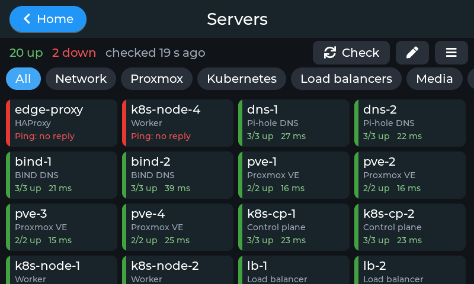 | 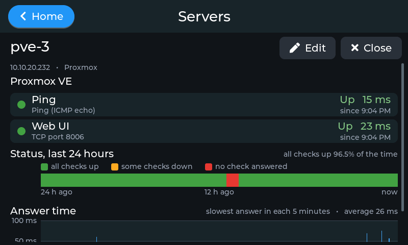 | 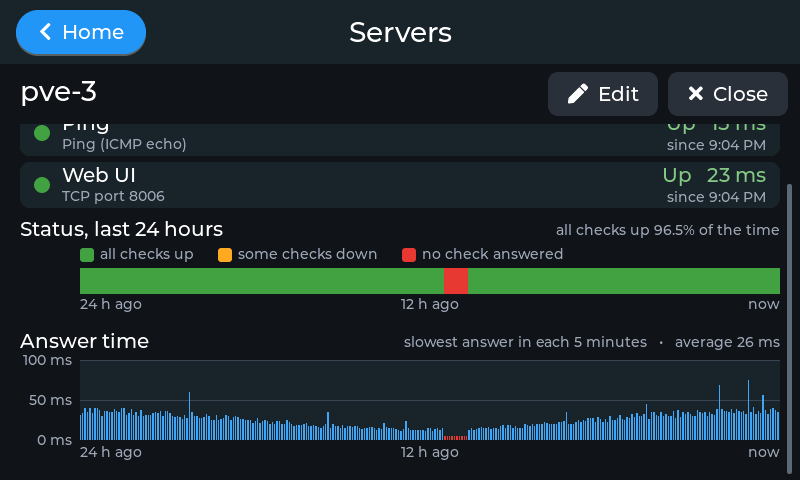 |
| 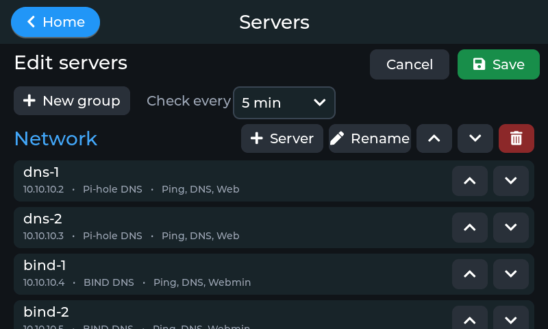 | 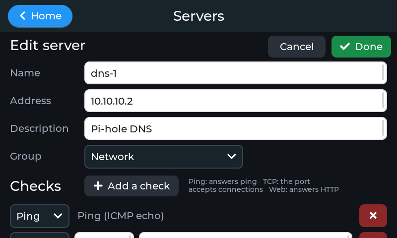 | 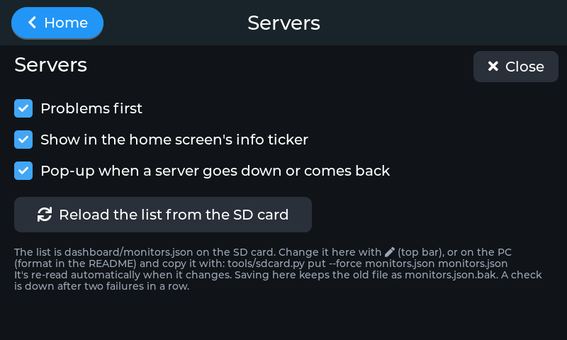 |

*Screenshots use a demo list with demo history; the addresses are real machines with their first
three numbers changed.*

- One card per server: green when all its checks pass, amber when some fail, red when all fail,
  grey until it's been checked. Problems are listed first (switch it off in the menu).
- Tabs for each group in the list. **Check** runs the checks at once; the pencil edits the list.
- Tap a card for each check: what it tests, up or down, the answer time or why it failed, and
  since when. Below them, two history charts (scroll down for the second):
  - **Status:** one block per 5 minutes: green when all checks passed, amber when some failed,
    red when none answered. The title line says how much of the time everything was up.
  - **Answer time:** a blue bar per 5 minutes for the slowest answer in it (ping when there is
    one), with a scale on the left and the average; a red mark where nothing answered.
  - Both cover the last 24 hours, zoomed to 2, 6 or 12 hours while there's less history. The
    history is kept in memory and saved to `dashboard/monitor_history.bin` on the card every
    15 minutes, so a restart loses at most the last 15 minutes. It needs the clock to be set.
    A server keeps its history while its name and address stay the same.
- A check only counts as down after **two failures in a row**, so a single lost packet doesn't
  turn a card red. Ping tries twice (a sleeping Wi-Fi device can miss the first one).
- Optional, in the menu: an item in the home screen's info ticker ("all 44 up" or which ones are
  down), and a pop-up when a server goes down or comes back.
- Checks keep running while the app is closed (for the ticker and the pop-ups).

**Editing the list on the display:** tap the pencil in the top bar (or **Edit** on a server's
page).

- Groups: **New group**, and on each group **+ Server**, **Rename**, ▲ ▼ to reorder and the bin
  to delete it (it asks first if the group isn't empty).
- Servers: tap one to edit its name, address, description and group, and its checks (up to 4:
  Ping, TCP port, or Web address); ▲ ▼ reorder them, and the form has **Delete this server**.
- **Check every** sets how often the checks run (15 s to 1 hour).
- Nothing changes until **Save**, which writes `dashboard/monitors.json` on the card and keeps
  the previous file as `monitors.json.bak`. The new list starts after the current round of
  checks. Leaving the app without saving drops the changes.
- After editing on the display, the card has the newest copy. Fetch it to the PC with
  `tools/sdcard.py get monitors.json monitor/monitors.json`.

**The list** is a JSON file on the SD card, `dashboard/monitors.json`. You can also write it on
the PC: it's re-read whenever it changes, so copying it over is enough:

```bash
~/.espressif/python_env/idf5.5_py3.14_env/bin/python tools/sdcard.py put --force my-servers.json monitors.json
```

[`monitor/monitors.example.json`](monitor/monitors.example.json) shows the format:

```json
{
 "format": "dashboard-monitor", "version": 1, "interval": 60,
 "groups": [
  {"name": "Servers", "hosts": [
   {"name": "proxmox", "host": "proxmox.home.lan", "what": "Proxmox VE host",
    "checks": ["ping", "tcp 8006 Web UI"]},
   {"name": "jellyfin", "host": "media.home.lan", "what": "Jellyfin media server",
    "checks": ["http http://media.home.lan:8096/health Jellyfin"]}
  ]}
 ]
}
```

- `host`: a name the display can look up in DNS (use the full name, e.g. `nas.home.lan`; the
  display has no search domain) or an IP address. `what` is a short description for the card.
- `checks` (up to 4 per host; just `ping` if left out):
  - `ping`: ICMP echo.
  - `tcp <port> [label]`: the port accepts a connection (SSH, databases, web UIs with
    self-signed HTTPS certificates, ...).
  - `http <url> [label]`: the page answers with any status below 500 (so a login page or a
    redirect counts as up). `https://` needs a certificate from a public authority; for
    self-signed ones use `tcp 443`.
- `interval`: seconds between rounds (15-3600, default 60). Up to 12 groups and 96 hosts.
- The list stays on the card and is never built into the firmware or sent anywhere. In this
  project, `monitor/monitors.json` is git-ignored, so a real list can be kept next to the example
  without being committed.

### Custom Apps (from the SD card)

| | |
|---|---|
| 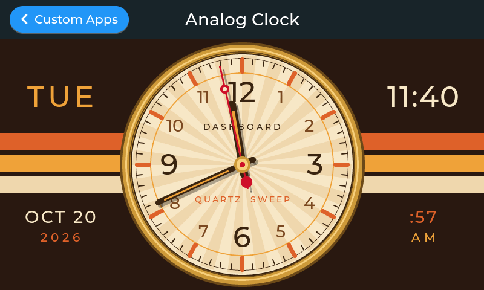 | 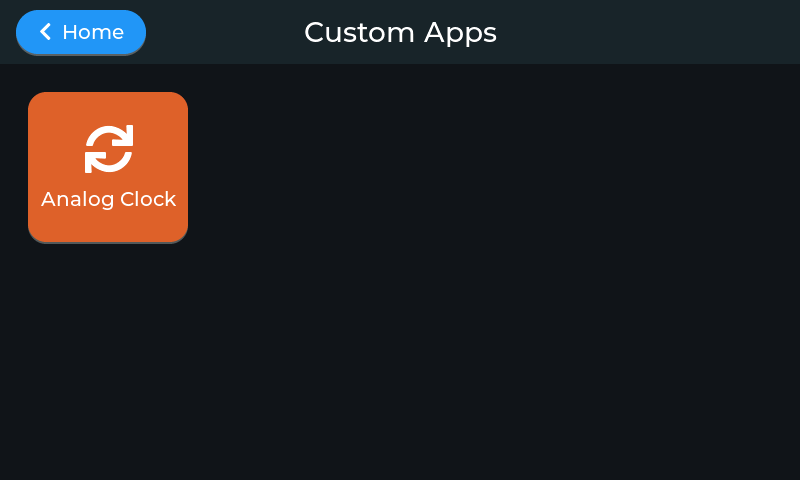 |
| 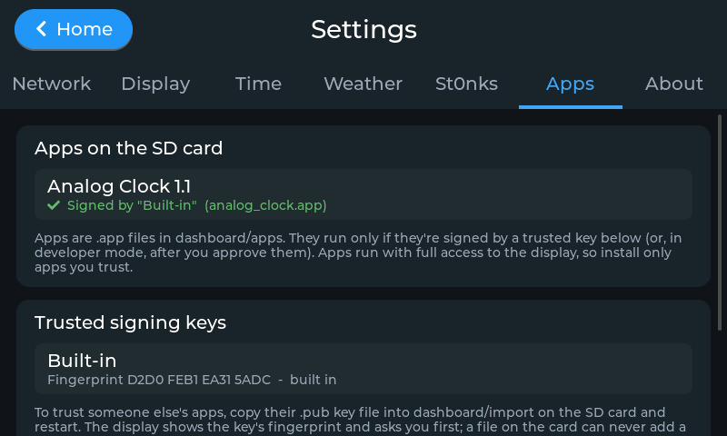 | 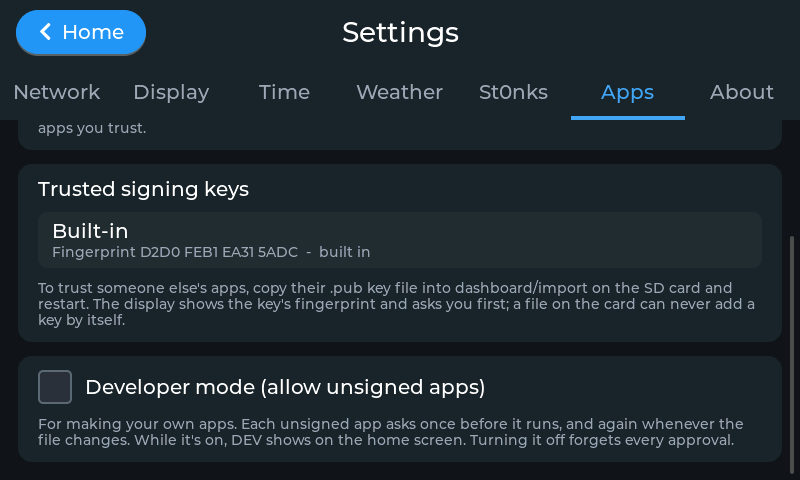 |

Apps can be loaded from the SD card without rebuilding the firmware. They live in the **Custom
Apps** folder (the elf on a shelf) and are loaded into memory when opened, then unloaded when you
leave. The example is a 1970s-style **Analog Clock** with a sweeping second hand.

- Copy a `.app` file into `dashboard/apps` and restart, or use `tools/sdcard.py put my.app
  apps/`, which shows the tile straight away. Updated versions of an app run the next time it's
  opened. An app can have its own picture for its tile and can ask for a folder (the games go in
  **Games**).
- **Only trusted apps run.** An app has full access to the display, so it must be signed with a
  trusted key (ECDSA P-256). Every `.pub` file in the project's `keys/` folder is built into the
  firmware and always trusted (here `keys/builtin_app_key.pub`, whose private half is in the
  git-ignored `local-keys/`). Built-in keys can only be changed by rebuilding the firmware.
- **Adding someone else's key**: put their `.pub` file in `dashboard/import` and restart. A
  full-screen, flashing warning shows the key's fingerprint and says to **stop and reject it if
  you didn't just add it yourself**. Reject is the big default button; Trust is small, in the far
  corner, and has to be held for 3 seconds. You then name the key yourself (the file's suggested
  name is shown but marked as not verified, since anyone can write any name). A file on the card
  can never add trust by itself. Added keys (up to 8) are listed in Settings > Apps with Remove.

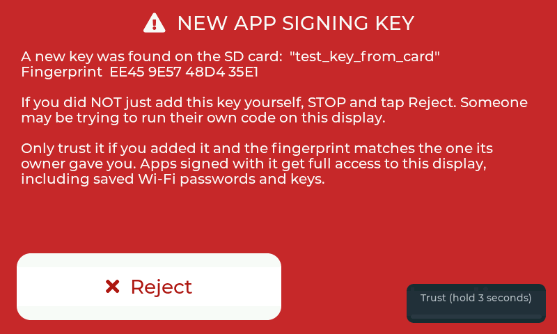

- **Settings > Apps** lists the card's apps (signed by whom, or why one won't run), the trusted
  keys (with Remove) and **developer mode**: like Android's, it lets unsigned apps run, each one
  only after you approve that exact file. **DEV** shows on the home screen while it's on.
- Trusted keys and developer mode are kept apart from the other settings, so restoring a
  settings backup from the card can't change them.

Making apps: see [apps/README.md](apps/README.md). In short, `tools/build_app.sh apps/my_app`
builds and signs one. Apps use LVGL and a small dashboard API
(`sdk/dashboard_sdk/include/dashboard_app.h`): messages, the clock, saved numbers, memory that
stays while the app is closed, and the game kit the games use.

### Games

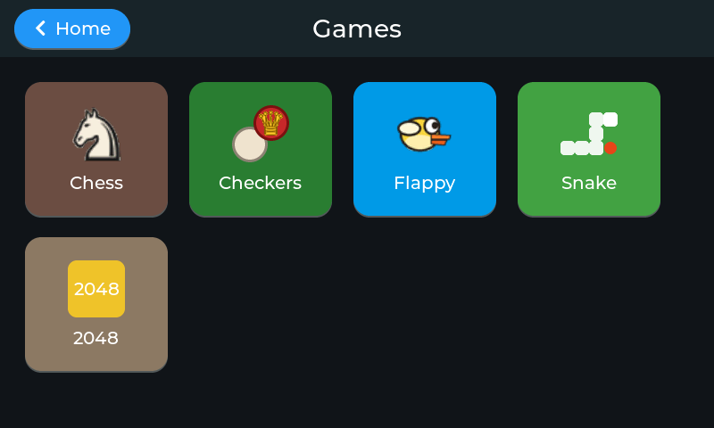

| | |
|---|---|
| 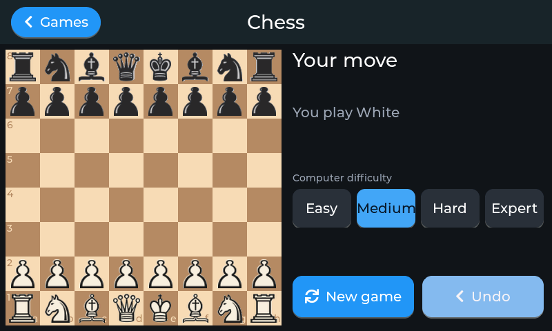 | 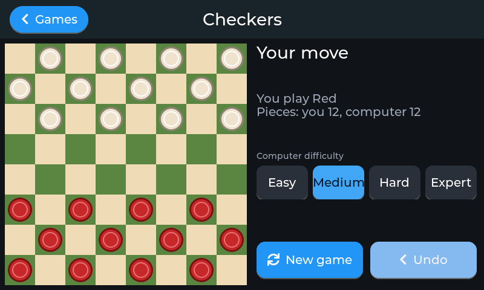 |
| **Chess**: full rules (castling, en passant, promotion, draws), alpha-beta search computer opponent with 4 levels, undo. | **Checkers**: American rules with forced captures and multi-jumps, 4 computer levels, undo. |
| 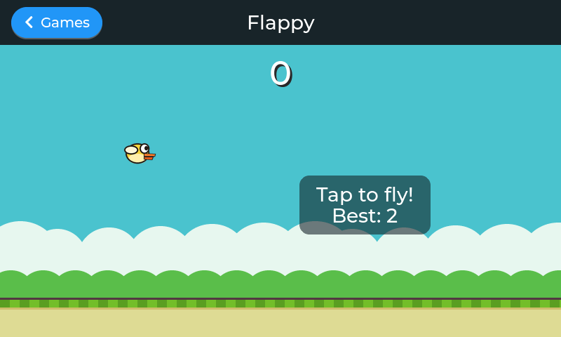 | 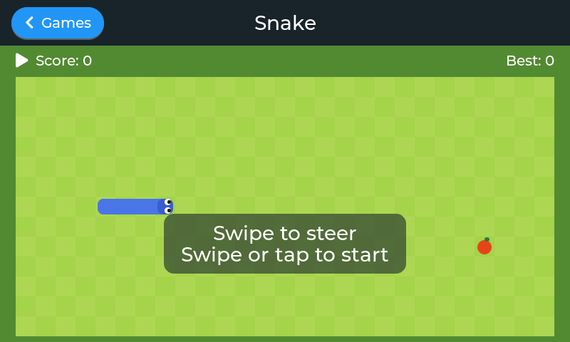 |
| **Flappy**: tap to flap through the pipes; speeds up and the gaps narrow as the score rises. | **Snake**: swipe to steer; gets faster as it grows. |
| 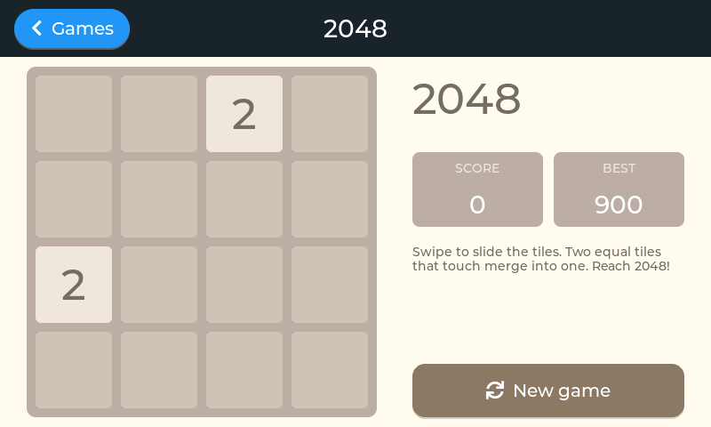 | |
| **2048**: swipe to slide and merge tiles, with slide and pop animations. | |

The games are **SD card apps** (`apps/chess`, `apps/checkers`, `apps/flappy`, `apps/snake`,
`apps/2048`), so they don't take up firmware space and can be updated without reflashing. Build
and copy them to the card once (the Games folder appears when they're there):

```bash
PY=~/.espressif/python_env/idf5.5_py3.14_env/bin/python
for g in chess checkers flappy snake 2048; do
    tools/build_app.sh apps/$g && $PY tools/sdcard.py put build/apps/$g.app apps/
done
```

The computer's chess and checkers moves are worked out in a background task, so the screen
stays responsive. Games keep their state when you leave and come back (until a restart), and
best scores and levels are saved (and included in settings backups).

### Choosing which apps are built in

`idf.py menuconfig` > **Dashboard apps** has a switch for each optional app (World Clock,
Timers, Weather, St0nks, Photos, Files, Jellyfin, DashPad, Servers). Switch off what you don't
use and rebuild; a firmware with all of them off is about 1.6 MB instead of 1.9 MB. Settings,
the launcher, SD card apps and the game kit are always built in.

### Settings

| | |
|---|---|
| 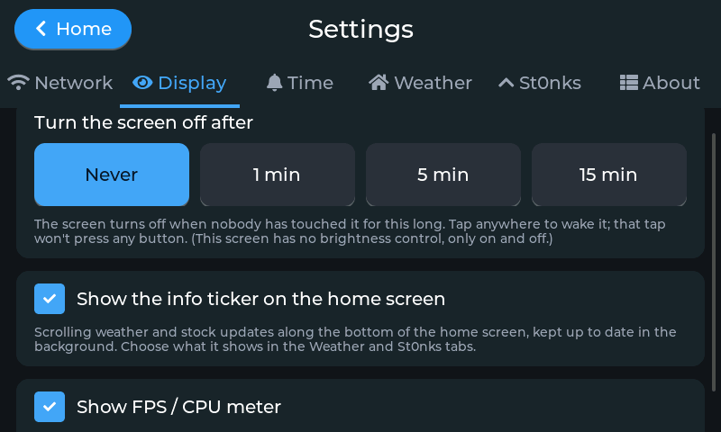 | 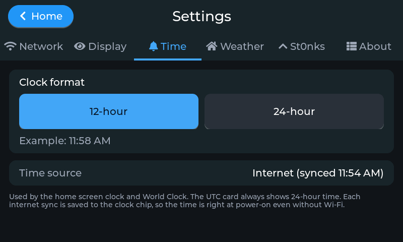 |
| 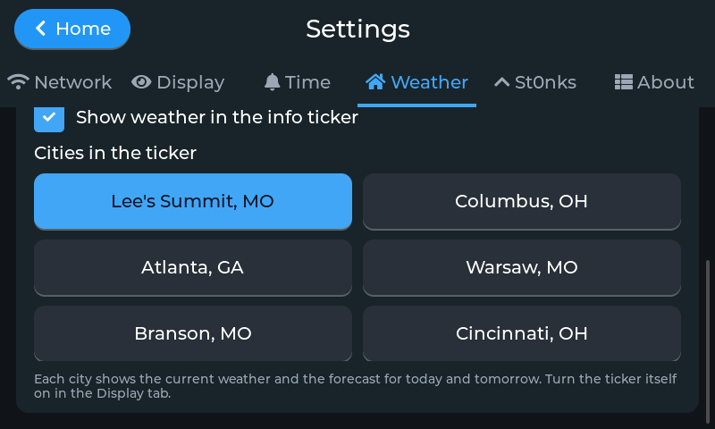 | 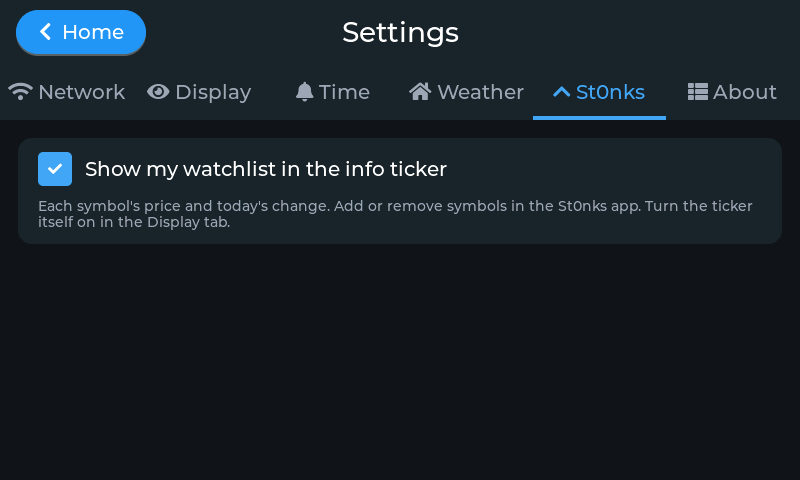 |
| 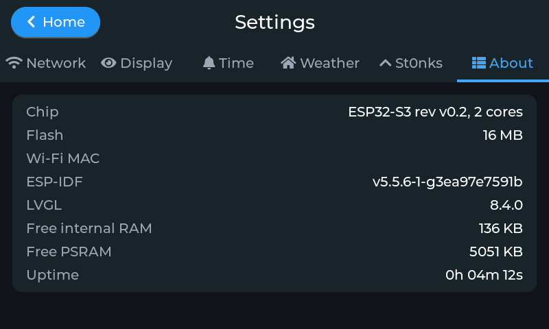 | 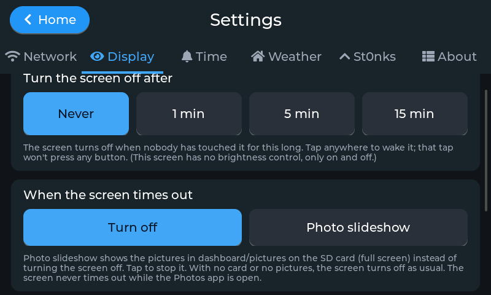 |

Tabs for Network (Wi-Fi status, signal and your saved networks, with Remove), Display (screen timeout, info ticker, FPS meter),
Time (12/24-hour, time source), Weather (default city, ticker cities), St0nks (show the watchlist
in the ticker), Apps (SD card apps, trusted keys, developer mode) and About (chip, memory,
versions, settings backup). Settings are stored in the ESP32's NVS flash
area and survive reboots and reflashing.

## Building and flashing

You need [ESP-IDF v5.5](https://docs.espressif.com/projects/esp-idf/en/v5.5/esp32s3/get-started/index.html).
LVGL 8.4 and the touch drivers are included in `components/`.

1. **Enable exFAT in ESP-IDF** (one-time; see [exFAT support](#exfat-support) below).
2. *Optional:* create `main/wifi_secrets.h` with a built-in Wi-Fi network (2.4 GHz only). This
   file is in `.gitignore` so it never gets committed. You can skip it and add networks from the
   SD card instead (see [Wi-Fi networks](#wi-fi-networks)).
   ```c
   #pragma once
   #define WIFI_SSID     "your network name"
   #define WIFI_PASSWORD "your password"
   ```
   *Optional:* `main/jellyfin_secrets.h` with your Jellyfin server and API key (also in
   `.gitignore`; see [Setting up Jellyfin](#setting-up-jellyfin)).
   *Optional:* your own app signing key. The repository's `keys/builtin_app_key.pub` is the
   project author's; to sign apps yourself, run
   `~/.espressif/python_env/idf5.5_py3.14_env/bin/python tools/appkey.py genkey --force`, which
   replaces it with yours (the private half goes to the git-ignored `local-keys/`).
3. Build and flash (board connected over USB-C):
   ```bash
   . ~/esp/esp-idf/export.sh
   idf.py build
   idf.py -p /dev/ttyACM0 flash
   ```
4. To watch the log output: `idf.py -p /dev/ttyACM0 monitor` (Ctrl+] to exit). The log shows
   your Wi-Fi network's name and IP address, so don't paste it anywhere public.

If flashing can't connect, hold **BOOT**, tap **RESET**, release BOOT and try again, then press
RESET once afterwards to start the app.

### exFAT support

Most microSD cards over 32 GB come formatted as **exFAT**. ESP-IDF supports exFAT, but ships with it
switched off and has no menuconfig setting for it, so you need to change one line in your ESP-IDF
install. Edit `$IDF_PATH/components/fatfs/src/ffconf.h` (for example
`~/esp/esp-idf/components/fatfs/src/ffconf.h`) and change

```c
#define FF_FS_EXFAT		0
```

to

```c
#define FF_FS_EXFAT		1
```

or run:

```bash
sed -i 's/^#define FF_FS_EXFAT\t\t0$/#define FF_FS_EXFAT\t\t1/' ~/esp/esp-idf/components/fatfs/src/ffconf.h
```

The build stops with an error that points here if this hasn't been done. Redo it after updating or
reinstalling ESP-IDF. (The project's `sdkconfig` also enables `CONFIG_FATFS_USE_LABEL`, which ESP-IDF
5.5 needs to compile with exFAT on.)

The flash is split into the settings area (NVS), a 6 MB app partition and a ~9.9 MB `storage`
partition reserved for future use (see `partitions.csv`).

## SD card

Insert a microSD card (FAT32 or exFAT) and restart the display (it only checks for a card at
startup). It creates one folder, `dashboard`, and never touches anything else on the card:

| Folder | What it's for |
|---|---|
| `dashboard/import/` | One-time inbox. Files here are read at startup, applied, then **erased**. |
| `dashboard/pictures/` | Pictures for the [Photos](#photos) slideshow and the screensaver (JPEG, PNG, GIF, BMP; folders inside are included). |
| `dashboard/screenshots/` | Screenshots: long-press the top bar on any screen (see [Taking screenshots](#taking-screenshots)). |
| `dashboard/backup/` | Settings backups (see [Backing up settings](#backing-up-settings)). Never include Wi-Fi networks. |
| `dashboard/apps/` | Apps (`.app` files) for the [Custom Apps](#custom-apps-from-the-sd-card) folder. Only signed or approved ones run. |

A `README.txt` in the `dashboard` folder explains the same thing.

### Wi-Fi networks

The display can remember up to **10 Wi-Fi networks** and connects to the **strongest one in range**,
so it can move between home, work and a phone hotspot. (2.4 GHz networks only; hidden networks
aren't supported.) A network set in `main/wifi_secrets.h` is also used, as a built-in extra.

**To add a network on the display:** **Settings > Network > Add network**. The display scans and
lists the networks in range (strongest first). Tap one, type its password with the on-screen
keyboard (tick **Show** to check what you typed) and tap **Save**. Open networks just need a
confirmation. Enterprise (work login) and WEP networks aren't supported.

**To add several at once from the SD card:**

1. With the card in your PC, create a plain text file named **`wifi.json`** in the
   `dashboard/import/` folder (insert the card in the display once first, so the folder exists).
   Use a plain text editor (Notepad, gedit, VS Code), not a word processor:

   ```json
   {
     "networks": [
       { "ssid": "Home-Network",  "password": "home password" },
       { "ssid": "Work-Guest",    "password": "work password" },
       { "ssid": "Coffee-Shop",   "password": "" }
     ]
   }
   ```

   - `ssid` is the network name, exactly as it appears on your phone (capitals matter).
   - `password` is 8-63 characters, or `""` for an open network.
   - Watch the punctuation: quotes around every name and password, a comma between networks,
     and no comma after the last one.
   - If Windows saves it as `wifi.json.txt`, that's fine too.
2. Put the card in the display and restart it (press **RESET** or unplug it for a moment).
3. A message at the bottom of the screen says **"Imported N Wi-Fi networks from the SD card"**.
   The networks now appear in **Settings > Network**.

**What happens to the file:** once the networks are saved inside the display, `wifi.json` is
**overwritten with blanks and then deleted**, so the passwords don't stay on the card (a plain
delete would leave them recoverable with undelete tools). The display doesn't need the file
after that, and the card can be removed.

**If something's wrong** (a typo in the file, a password that's too short, or more than 10
networks in total), nothing is imported, the file is left on the card, and a message on screen
says what to fix.

**To change a password:** import a `wifi.json` with the same network name and the new password.

**To remove a network:** **Settings > Network**, tap **Remove** next to it and confirm. It's
deleted from the display's memory straight away, and if it was the network in use, the display
switches to another saved network.

**To erase them for good:** **Settings > Network > Securely wipe all saved networks**. Remove takes
a network off the list, but like most flash storage, the display's settings area only *marks* old
data as deleted; the password stays in the chip until that space is reused. The wipe copies your
other settings aside, erases the whole settings area, and puts the other settings back, so every
saved and previously removed network is really gone (the built-in network isn't affected).

Saved networks live in the ESP32's internal NVS storage, like the other settings. That storage
isn't encrypted, so treat the device itself like anything else that knows your Wi-Fi password.

### Backing up settings

**Settings > About > Back up settings to the SD card** saves every setting to
`dashboard/backup/settings_<date>_<time>.json`: clock format, screen timeout, ticker and FPS
options, weather cities, the St0nks watchlist, game levels and best scores. **Wi-Fi networks and
passwords are never included.**

**To restore:** copy a backup file from `dashboard/backup/` into `dashboard/import/` (keep the
`settings....json` name) and restart the display. It replaces the current settings, deletes the
copy in `import/` (the original in `backup/` stays), shows "Restored N settings" and restarts once
more so every app picks up the restored values. If the file is damaged or isn't a backup, nothing
is changed, the file stays, and a message says why.

The backup is plain text, so you can look at it (or carefully edit it) on your PC.

## Taking screenshots

Long-press an empty part of the top bar on any screen (the display pauses for a few seconds).
Full-screen alerts (an alarm, the new-key warning) cover the top bar; take those from the PC with
`tools/sdcard.py shot` (see [Copying files over USB](#copying-files-over-usb)). Screenshots
include them.

- **With an SD card in:** the screen is saved as a BMP image in `dashboard/screenshots/`, named
  after the date and time (for example `shot_20261019_213005.bmp`), and a message shows the name.
  Any image viewer opens BMP files.
- **Without a card:** the screen is sent over the USB cable instead. On the PC, run the receiver,
  which saves each one as a PNG in `docs/screenshots/`:

```bash
~/.espressif/python_env/idf5.5_py3.14_env/bin/python tools/screenshot.py
```

(Use the Python that comes with ESP-IDF, which has `pyserial`, and close `idf.py monitor` first.)

To copy screenshots from the card without taking it out, see the next section.

## Copying files over USB

`tools/sdcard.py` copies files to and from the SD card while it stays in the display, over the
same USB cable used for flashing. Only the card's `dashboard/` folder can be reached.

```bash
PY=~/.espressif/python_env/idf5.5_py3.14_env/bin/python
$PY tools/sdcard.py ls pictures                  # list a folder (paths are inside dashboard/)
$PY tools/sdcard.py put *.jpg pictures/          # PC -> card
$PY tools/sdcard.py get screenshots ./shots      # card -> PC (one file or a whole folder)
$PY tools/sdcard.py rm pictures/old.jpg          # a file or an empty folder
$PY tools/sdcard.py mkdir pictures/holiday
$PY tools/sdcard.py shot                         # take a screenshot now
$PY tools/sdcard.py mem                          # memory report (RAM, PSRAM, task stacks)
```

- `shot` takes a screenshot without touching the screen, for screens whose top bar can't be
  long-pressed (full-screen alerts such as an alarm or the new-key warning, which screenshots
  include).
- About 200 KB/s each way. Every 2 KB chunk is checked and acknowledged, so a damaged or lost chunk
  is sent again, and a file is only saved once its whole-file checksum matches. Interrupted copies
  leave nothing behind.
- `put` won't replace an existing file unless you add `--force`. File names must be plain ASCII.
- The display shows a message for each file it receives or deletes.
- Files named `wifi*.json` are never sent to the PC, and the dashboard's own folders can't be
  removed. Close `idf.py monitor` and `screenshot.py` first: only one program can use the port.
- A `wifi.json` put into `import/` is imported (and securely erased) at the next restart, the same
  as one copied onto the card.

## Security and privacy

In one place, what's private and how it's protected:

- **Secrets files** `main/wifi_secrets.h` and `main/jellyfin_secrets.h` are in `.gitignore`. Their
  values are built into the firmware, so don't share firmware files.
- **Wi-Fi passwords** are kept in the display's NVS flash, never written to the log or to settings
  backups. An imported `wifi.json` is overwritten and deleted after import, and the Files app and
  the USB tool never show or send `wifi*.json` files. Settings > Network can securely wipe every
  saved network (removing one only marks it deleted in flash).
- **The Jellyfin key** lives in its own storage area, not in backups or the log, and is never
  shown on screen (only its last 4 characters). With an `http://` server it crosses your network
  unencrypted.
- **DashPad's PC helper** only runs commands from its own config file and only accepts requests
  signed with the paired secret. Treat exported DashPad layouts as private if they contain webhook
  URLs, which often work as passwords.
- **Apps from the SD card** have full access to the display, so they only run when signed by a
  trusted key (built in from `keys/`, or added after an on-screen warning and confirmation) or,
  in developer mode, after you approve each file. The private signing key (`local-keys/`) is
  git-ignored: **back it up somewhere private**, since GitHub doesn't have it. Keys and developer
  mode are stored apart from settings, so a restored backup can't change them.
- **Physical access:** anyone with the display and a USB cable can flash new firmware, which
  bypasses all of the above. Stopping that needs the ESP32's Secure Boot and Flash Encryption
  (one-time fuses), which this project doesn't use.
- **Screenshots and logs** can show your Wi-Fi name, IP address and other details; the log over
  USB includes them. Check before sharing either.

## Running the tests

The parts that don't need the screen are plain C and are tested on the PC (`gcc` and the system
Python with Pillow):

```bash
# Chess and checkers engines (move generation must match known perft counts;
# the checkers test plays full games, so it takes a few minutes)
gcc -O2 -I sdk/dashboard_sdk/include -I apps/chess/main -o /tmp/chess_test test/host/chess_test.c apps/chess/main/chess_engine.c && /tmp/chess_test
gcc -O2 -I sdk/dashboard_sdk/include -I apps/checkers/main -o /tmp/checkers_test test/host/checkers_test.c apps/checkers/main/checkers_engine.c && /tmp/checkers_test

# PNG/GIF decoder: pixels checked against Pillow, plus 3000 damaged files (must not crash)
test/host/pic_decode/run.sh

# Streaming JSON filter used by the Jellyfin app
test/host/json_skip/run.sh
```

## Project layout

| Path | What's there |
|---|---|
| `main/launcher.c` | Home screen, folders, app screens, screen timeout |
| `main/app_*.c` | One file per built-in app (optional ones are switched in `main/Kconfig.projbuild`) |
| `apps/chess`, `apps/checkers`, `apps/flappy`, `apps/snake`, `apps/2048` | The games (SD card apps); the chess and checkers engines are plain C, tested on a PC in `test/host/` |
| `main/game_common.c` | The game kit (board widget, background worker, dialogs, swipe input), also used by apps |
| `main/ticker.c` | Home screen info ticker |
| `main/settings.c` | Saved settings (NVS) |
| `main/net_time.c`, `main/rtc.c` | Wi-Fi, NTP time and the RTC chip |
| `main/sd_card.c` | microSD card (FAT32 / exFAT): `dashboard` folders and the import inbox |
| `main/wifi_list.c` | Saved Wi-Fi networks (up to 10, in NVS) |
| `main/settings_backup.c` | Settings backup / restore on the SD card |
| `main/photo_frame.c`, `main/pic_decode.c` | Slideshow engine (Photos app and screensaver); JPEG/BMP and PNG/GIF decoding |
| `main/app_files.c` | File manager |
| `main/clock_tools.c`, `main/app_timers.c` | Timers, stopwatch, alarms and their alerts; the Timers app |
| `main/jellyfin.c`, `main/app_jellyfin.c` | Jellyfin client (server settings, polling, cover art, remote control) and the app |
| `main/waveshare_rgb_lcd_port.c`, `main/lvgl_port.c` | Display, touch and LVGL setup, from Waveshare's demo |
| `main/dashpad.c`, `main/app_dashpad.c`, `main/usb_kbd.c` | DashPad: layout, actions and pairing; the app; the USB keyboard |
| `main/monitor.c`, `main/app_monitor.c` | Servers: the checks (ping, TCP, HTTP) and the app |
| `monitor/` | Example server list (`monitors.json` here is git-ignored, for your own) |
| `dashpad/`, `tools/dashpad_helper.py` | DashPad example layout and helper config; the PC helper |
| `main/usb_files.c`, `tools/sdcard.py` | SD card file transfer over USB |
| `main/ext_apps.c`, `main/app_keys.c`, `main/app_symbols.c` | SD card apps: loading, signature checks / trusted keys / developer mode, and what apps may call |
| `sdk/`, `apps/`, `keys/` | App SDK (headers and build settings), apps (games and the analog clock example), the built-in public signing key |
| `tools/appkey.py`, `tools/build_app.sh` | Make signing keys; build and sign apps |
| `tools/sdcard.py`, `tools/screenshot.py` | USB file transfer (and `shot`); screenshot receiver when there's no SD card |
| `tools/gen_game_images.py`, `gen_stonks_icon.py`, `gen_elf_icon.py` | Generate the built-in images (the games' pictures and icons in `apps/`, `stonks_icon.c`, `elf_icon.c`) |
| `tools/gen_app_symbols.py` | Generates `main/app_symbols.c`, what SD card apps may call; rerun after a build when LVGL's settings change |
| `test/host/` | Tests that run on the PC (see [Running the tests](#running-the-tests)) |
| `CLAUDE.md` | Detailed developer notes |

## Credits

- Started from Waveshare's ESP-IDF LVGL porting demo for this board.
- [LVGL](https://lvgl.io/) 8.4 (MIT licence).
- Espressif's [elf_loader](https://components.espressif.com/components/espressif/elf_loader) 1.3.5
  and cmake_utilities (Apache 2.0), in `components/`.
- [TinyUSB](https://github.com/hathach/tinyusb) (MIT) and Espressif's esp_tinyusb (Apache 2.0) for
  DashPad's USB keyboard, in `components/` (examples and board files removed).
- Weather data: [Open-Meteo](https://open-meteo.com/) (CC BY 4.0).
- Stock prices: Yahoo Finance; earnings dates: Nasdaq. For personal use; data is delayed and not
  investment advice.
- St0nks icon built from [Twemoji](https://github.com/twitter/twemoji) graphics by Twitter (CC BY 4.0).
- Fonts: Montserrat (bundled with LVGL).
